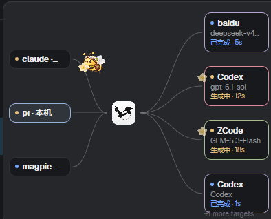
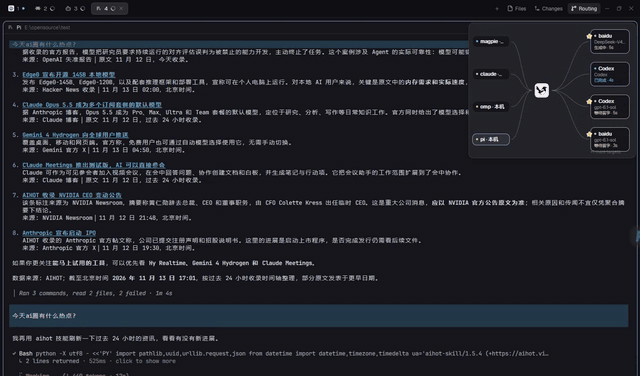

# Herdr Magpie Routing

[English](README.md) · [简体中文](README.zh-CN.md)

A small Herdr mod that visualizes Magpie gateway routing in a floating panel.



## Demo

[](demo/routing-demo.mp4)

[▶ Open the full routing demo video](demo/routing-demo.mp4)


## What it does

It reads Magpie's live trace from `http://127.0.0.1:3425/v1/magpie/trace` and displays:

```text
Agent  →  Magpie  →  provider/model
Agent  ←  Magpie  ←  provider/model
```

The moving bee carries one petal packet. The packet stays at the provider while the response is generated, then the return bee carries it home. Completed cards linger briefly, but the packet is removed after delivery.

This mod is observational. It does not modify Magpie routing, provider accounts, prompts or gateway settings.

## Installation by an Agent

Give the Agent this repository URL and ask it to read the complete installation contract:

[`https://github.com/liangjfblue/herdr-magpie-routing/blob/main/AGENTS.md`](https://github.com/liangjfblue/herdr-magpie-routing/blob/main/AGENTS.md)

The user does not need to download this repository first. The Agent can read the raw project files from GitHub and install only the required mod files into the user's existing Herdr setup.

### Copyable English prompt

> Read [`https://github.com/liangjfblue/herdr-magpie-routing/blob/main/AGENTS.md`](https://github.com/liangjfblue/herdr-magpie-routing/blob/main/AGENTS.md) before changing files. Install the Routing mod into my existing Herdr setup without overwriting my layout or mods. Add the floating panel and a Routing toggle beside Files/Changes, run the required checks, and show me the diff before finishing.

## Requirements

- Herdr with GPUI mod support;
- a running Magpie gateway on port `3425`;
- `curl` on the machine where the trace is read;
- permission to install a trusted Herdr mod that executes `curl` via Herdr's `exec` API.

The mod reads route metadata including Agent, provider/model, session, retry and status. It does not read or store prompt text.

## Repository contents

```text
AGENTS.md              Agent-facing installation contract
mods/routing/          Installable Herdr mod and visual assets
tests/                 Offline lifecycle and Magpie-parity tests
```

## Local validation

From this repository:

```sh
herdr-app check <herdr-root>/mods/routing
node --test tests/routing-flight.test.cjs tests/routing-lifecycle.test.cjs
MAGPIE_ROOT=/path/to/magpie node --test tests/routing-magpie-parity.test.cjs
```

On Windows, use the equivalent environment-variable syntax for your shell.

## Security and privacy

This is trusted code. It launches `curl` through Herdr and reads the Magpie trace endpoint. Review the source before installing. Do not publish screenshots containing paths, session names, account names or prompt content.

## Asset provenance

The flower, bee carrier and center bee icon are GPT-generated artwork supplied by the user. The user confirmed that they may be used in this project. The center icon replaces the previous Magpie mark. This project does not claim Magpie or Herdr trademarks; verify any trademark or logo requirements before publishing a public release.

## License

No public code license has been selected yet. Keep this repository private until a maintainer chooses a license and resolves the bee asset rights.
