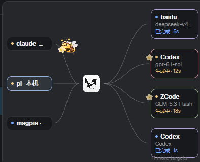
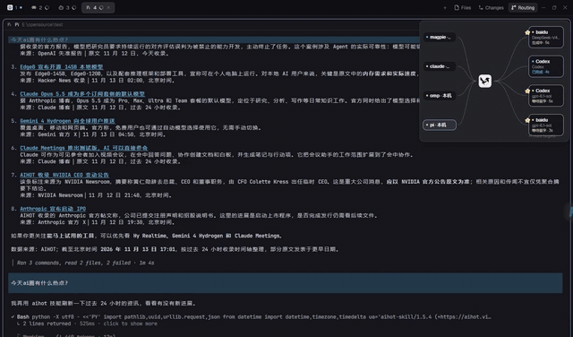

# Herdr Magpie Routing

[English](README.md) · [简体中文](README.zh-CN.md)

一个安装到 Herdr 的小型 mod，用于在右上角浮动面板中实时展示 Magpie 网关的请求路由过程。



## 演示

[](demo/routing-demo.mp4)

[▶ 打开完整路由演示视频](demo/routing-demo.mp4)

## 功能

它读取 Magpie 的实时 trace：

```text
Agent  →  Magpie  →  provider/model
Agent  ←  Magpie  ←  provider/model
```

动画中的蜜蜂会携带一朵完整的五瓣花：

- 请求从 Agent 经过 Magpie 飞往 Provider；
- Provider 生成响应期间，花朵停留在 Provider；
- 响应完成后，返回蜜蜂携带同一朵花回到 Agent；
- 回程结束后，花朵和飞行动画清理；
- 已完成的路由卡片会短暂保留，方便查看状态。

这个 mod 只观察路由，不会修改 Magpie 的路由策略、Provider 账号、提示词或网关设置。

## 让 Agent 安装

完整的安装契约在这里：

[`https://github.com/liangjfblue/herdr-magpie-routing/blob/main/AGENTS.md`](https://github.com/liangjfblue/herdr-magpie-routing/blob/main/AGENTS.md)

用户不需要提前下载或克隆整个仓库。Agent 可以直接从 GitHub 读取上述文件，并只把必要的 mod 文件安装到用户现有的 Herdr 配置中。

### 可直接复制给 Agent 的中文指令

> 请先阅读这个完整的安装说明文件：https://github.com/liangjfblue/herdr-magpie-routing/blob/main/AGENTS.md 。不需要我提前下载或克隆整个仓库。请将 Routing mod 安装到我现有的 Herdr 配置中，不要覆盖我已有的布局或 mod；在 Files/Changes 按钮旁边增加 Routing 开关，并添加右上角浮动面板。安装完成后运行必要的检查和测试，最后展示修改 diff。安装前请先检查我的 Herdr 根目录、当前布局和现有 mod；如果存在同名文件，不要直接覆盖。

### 给 Agent 的英文指令

> Read [`https://github.com/liangjfblue/herdr-magpie-routing/blob/main/AGENTS.md`](https://github.com/liangjfblue/herdr-magpie-routing/blob/main/AGENTS.md) before changing files. Install the Routing mod into my existing Herdr setup without overwriting my layout or mods. Add the floating panel and a Routing toggle beside Files/Changes, run the required checks, and show me the diff before finishing.

## 使用要求

- 支持 GPUI mod 的 Herdr；
- 正在运行的 Magpie 网关，默认端口为 `3425`；
- 读取 trace 的机器上有 `curl`；
- 用户允许安装一个可信的 Herdr mod，因为它会通过 Herdr 的 `exec` API 执行 `curl`。

mod 读取 Agent、Provider/模型、会话、重试和状态等路由元数据，不读取或保存提示词正文。

## 仓库内容

```text
AGENTS.md              给 Agent 读取的安装契约
mods/routing/          可安装的 Herdr mod 和视觉素材
demo/                  README 使用的截图和演示视频
tests/                 离线生命周期测试和 Magpie parity 测试
```

## 本地验证

在本仓库目录执行：

```sh
herdr-app check <herdr-root>/mods/routing
node --test tests/routing-flight.test.cjs tests/routing-lifecycle.test.cjs
MAGPIE_ROOT=/path/to/magpie node --test tests/routing-magpie-parity.test.cjs
```

Windows 使用对应 shell 的环境变量写法。

## 安全和隐私

这是可信代码。它会通过 Herdr 执行 `curl`，读取 Magpie trace endpoint。安装前请审阅源码。不要发布包含本机路径、会话名称、账号名称或提示词内容的截图。

安装 Agent 会先检查用户的 Herdr 根目录、当前布局和已有 mod；不会直接覆盖同名文件，也不会把本仓库的 `.git`、测试、文档或运行时数据复制到用户目录。

## 素材来源

花朵、飞行蜜蜂和中间的蜜蜂图标都是用户提供的 GPT 生成插画，用户确认可以用于本项目。中间图标已替换原来的 Magpie 标志。本项目不声明拥有 Magpie 或 Herdr 的商标权。公开发布前请自行确认相关商标或 Logo 使用要求。

## 许可证

目前还没有选择公开代码许可证。正式公开发布前，请为代码选择许可证，并确认第三方名称、图标和素材的使用要求。
